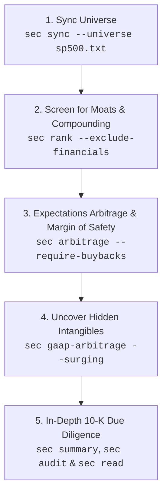

# SEC Filing Reader & Fundamentals Screener

A command-line tool to fetch SEC EDGAR company facts and filing history into a local SQLite database, inspect multi-year fundamentals, run forward and reverse DCF valuations, and rank an investable universe.

## Quick Start

```sh
go build -o sec ./cmd/sec
export SEC_USER_AGENT="Research App contact@example.com"
```

SEC EDGAR requires an identifying `User-Agent` with contact information via `SEC_USER_AGENT` or `--ua`.

## Commands

### Sync Universe

Download `us-gaap`, `ifrs-full`, and `dei` facts plus complete filing histories (including amendments) into `data/sec.db`:

```sh
./sec sync AAPL MSFT GOOGL AMZN NVDA META
./sec sync --universe sp500.txt --workers 4
./sec sync --universe all-tickers.txt --workers 4
```

`sync` runs up to 4 concurrent workers (`--workers 1` for sequential execution) sharing an SEC-compliant rate limiter.

### Financial Summary

Display 3 to 5 years of annual metrics:

```sh
./sec summary AAPL
./sec summary AAPL --years 3
```

Reports revenue, operating income, SG&A, R&D, intangible amortization, intangible-adjusted operating income, net income, operating cash flow (OCF), CapEx, D&A, free cash flow (`OCF - CapEx`), stock-based compensation (SBC), an SBC-adjusted FCF proxy, cash, borrowings, stockholders' equity, intangible capital, adjusted invested capital, intangible-adjusted ROIC, and share counts (period-end outstanding when available, otherwise diluted weighted-average).

### Discounted Cash Flow (`dcf`)

Run a two-stage DCF model with projected cash flows, an EV-to-equity bridge, per-share value, and a discount/terminal-growth sensitivity matrix:

```sh
./sec dcf AAPL
./sec dcf AAPL --growth 8 --discount 9 --terminal 2.5 --years 5
./sec dcf GOOGL --mode revenue --growth 9 --beta 1.1 --market-cap 2.5e12
./sec dcf META --mode revenue --capex-mode normalized
./sec dcf PLTR --debt 0
```

- **Forecast Modes**:
  - `fcf` *(default)*: Grows `OCF - CapEx` from the 3-year historical FCF CAGR (when 4 consecutive positive annual periods exist). Raw CapEx fades the growth wedge (`CapEx - D&A`) linearly to zero by the terminal year; `--capex-mode normalized` (or `--normalize-capex`) sets CapEx equal to D&A throughout.
  - `revenue`: Builds unlevered FCFF from forecast revenue (defaulting to the 3-year revenue CAGR), trailing operating margin, effective tax rate, D&A, CapEx, and change in net working capital (current assets less current liabilities).
- **WACC & Capital Structure**:
  - When `--discount` is omitted, WACC is estimated from `--risk-free` (default `4.84%`, [Nov 5, 2026 US 10Y Treasury](https://home.treasury.gov/resource-center/data-chart-center/interest-rates/TextView?field_tdr_date_value_month=202611&type=daily_treasury_yield_curve)), `--erp` (`5.5%`), `--beta` (`1.0`), `--cost-debt` (historical interest over average debt, fallback `5.0%`), and `--tax` (historical effective rate, fallback `21%`).
  - Because EDGAR does not report market prices, pass `--beta` and `--market-cap` (in reported currency units); otherwise book equity and net debt (`max(0, debt - cash)`) weight WACC while the equity bridge adds cash and subtracts gross debt.
  - Pass `--debt 0` when a filing confirms zero debt without an explicit zero-valued XBRL fact.

### Reverse DCF & Expectations Arbitrage

Invert the DCF model to solve for the five-year growth rate implied by a market capitalization. The default reverse mode uses the SEC summary's SBC-adjusted FCF proxy, with FCF and revenue-driven FCFF also available:

```sh
./sec dcf AAPL --reverse --market-cap 3400000000000
./sec dcf MSFT --reverse --mode fcf --market-cap 3000000000000
./sec dcf GOOGL --reverse --mode revenue --market-cap 2200000000000
```

The inverse uses the same WACC inputs, effective tax-rate estimate, debt-cost estimate, CapEx normalization, and terminal-growth convention as the forward DCF. Market capitalization must use the currency units reported in the SEC facts.

Screen the rank universe for high-quality nonfinancial companies, then rank candidates by historical growth less market-implied growth:

```sh
./sec arbitrage --prices quotes.csv --min-score 75 --min-roic 15
./sec arbitrage --fetch-prices --min-score 75 --min-roic 15 --require-buybacks
./sec arbitrage --prices valuations.json --universe sp500.txt
```

`--prices` accepts CSV/TSV with `TICKER,PRICE` or `TICKER,MARKET_CAP` headers, or JSON ticker/value records. A legacy `TICKER,VALUE` column treats values below $1 million as share prices and larger values as market caps. `--fetch-prices` requests Yahoo Finance v8 chart prices, with Stooq quotes for symbols Yahoo does not return. Share prices are multiplied by SEC period-end shares outstanding, then diluted weighted-average shares, with a direct SEC facts lookup if summary share counts are unavailable. The table includes separate historical-company and SIC-peer-median alpha spreads; the ranked historical growth falls back to revenue CAGR when cash-flow history is unavailable.

### Intangible-Capitalized Value ("Modern GAAP Arbitrage")

Standard GAAP accounting—and therefore retail screeners—treats physical CapEx as an asset, but treats foundational R&D (`ResearchAndDevelopmentExpense`) and brand/customer acquisition (`SellingGeneralAndAdministrativeExpense`) as immediate 100% operating expenses. This artificially depresses Operating Income, Book Equity, and Invested Capital for software, biotech, and high-moat consumer firms.

The **Peters & Taylor Total Q / Damodaran Intangible Capitalization model** is implemented directly in `summary` and `gaap-arbitrage`:

- **Capitalize R&D & 30% of SG&A**:
  - R&D is capitalized and amortized linearly over 5 years (20% per year).
  - 30% of SG&A is capitalized as brand/organizational capital and amortized linearly over 3 years (33.33% per year).
- **Core Formulas**:
  $$\text{Intangible Capital}_t = \sum_{k=0}^4 \left(1 - \frac{k}{5}\right) \text{R\&D}_{t-k} + \sum_{k=0}^2 \left(1 - \frac{k}{3}\right) (0.30 \times \text{SG\&A}_{t-k})$$
  $$\text{Amortization}_t = \frac{1}{5} \sum_{k=1}^5 \text{R\&D}_{t-k} + \frac{1}{3} \sum_{k=1}^3 (0.30 \times \text{SG\&A}_{t-k})$$
  $$\text{Adjusted EBIT}_t = \text{Operating Income}_t + \text{R\&D}_t + 0.30 \times \text{SG\&A}_t - \text{Amortization}_t$$
  $$\text{Adjusted Invested Capital}_t = \text{Stockholders' Equity}_t + \text{Debt}_t - \text{Cash}_t + \text{Intangible Capital}_t$$
  $$\text{Intangible-Adjusted ROIC}_t = \frac{\text{Adjusted EBIT}_t \times (1 - \text{taxRate})}{\frac{\text{Adjusted Invested Capital}_t + \text{Adjusted Invested Capital}_{t-1}}{2}}$$

Inspect any company's intangible adjustments across 3 to 5 years:

```sh
./sec summary AAPL
./sec summary MSFT
```

Screen for companies that look unprofitable or "expensive" on standard GAAP metrics (and are ignored by traditional value funds), but exhibit surging Intangible-Adjusted ROIC and high Intangible-Adjusted Owner Earnings Yield:

```sh
./sec gaap-arbitrage --fetch-prices --min-adj-roic 15 --min-yield 3.5
./sec gaap-arbitrage --prices quotes.csv --surging --screen-expensive
./sec gaap-arbitrage --min-yield 0 --sort roic --universe sp500.txt
```

- **Screener Options**:
  - `--min-adj-roic PCT`: Minimum Intangible-Adjusted ROIC (default `15%`).
  - `--min-yield PCT`: Minimum Intangible-Adjusted Owner Earnings Yield (`(FCF - SBC + Net Intangible Investment) / Market Cap`, default `3.5%`; pass `0` to screen without valuation).
  - `--surging`: Require expanding Adjusted ROIC (latest > prior year or 3Y average, or ROIC spread $\ge 5\%$).
  - `--screen-expensive`: Require company to appear expensive or unprofitable under GAAP (GAAP P/E $\ge 25$, negative P/E / GAAP loss, or ROIC spread $\ge 5\%$).
  - `--max-gaap-roic PCT`: Cap standard GAAP ROIC to isolate firms where GAAP expensing creates the widest distortion.
  - `--sort yield|roic|spread|score`: Sort table by Owner Yield, Adjusted ROIC, ROIC Delta spread, or composite arbitrage score.
  - `--prices FILE` / `--fetch-prices`: Supply valuation file or pull live market prices from Yahoo Finance / Stooq.

### Rank Companies

Screen and rank synced companies by within-industry percentiles:

```sh
./sec rank
./sec rank --universe sp500.txt --years 6 --min-revenue 100000000
./sec rank --exclude-financials
```

- **Eligibility**: Requires a recent filing, 6 annual periods for 5-year trends (`--years 5` for 4-year trends), latest USD revenue ≥ `--min-revenue` (default `$100M`), and positive net income over the last 3 years. Nonfinancials also require positive latest OCF and pass a solvency check when cash and debt facts are present.
- **Peer Grouping**: Uses 2-digit SEC SIC major groups (broadening to SIC divisions when a group has fewer than 5 companies). Missing metrics are shown as `—` and remaining weights are renormalized.

| Model | Scope | Factor Weights |
| :--- | :--- | :--- |
| **Nonfinancial** | Standard | **20%** ROIC · **20%** Owner-earnings margin (`FCF - SBC`) · **15%** Revenue CAGR · **15%** Operating margin & consistency · **10%** Net cash/assets · **10%** EPS CAGR · **10%** Share reduction |
| **Financial** | SIC 6000–6799 | **30%** ROE · **20%** Revenue CAGR · **20%** Book value/share CAGR · **20%** EPS CAGR · **10%** Share reduction |

> [!NOTE]
> Share trends use diluted weighted-average shares and automatically adjust for common split ratios outside a filing's comparative periods (marked with `*`). Rankings are peer-relative screens based on reported XBRL facts, not market-price valuations.

### Fact Audit & Diagnostics (`audit`)

Scan the SQLite database to diagnose XBRL taxonomy coverage, detect reporting gaps across multi-year periods, or inspect raw concept tags for a specific company:

```sh
./sec audit                                # Summary of universe taxonomy coverage and filing completeness
./sec audit --gaps-only                    # List only companies with missing periods or fundamental gaps
./sec audit AAPL                           # Deep-dive diagnostic on AAPL: resolved metrics and discovered tags
```

### Inspect, List & Export

```sh
./sec read AAPL                            # Browse filings and open SEC URLs (n/p move, /text search, q quit)
./sec list                                 # List synced tickers, company names, and CIKs
./sec export AAPL --format csv > aapl.csv  # Export extracted facts as CSV or JSON
```

---

## How Warren Buffett Would Use This Tool

> *"It's far better to buy a wonderful company at a fair price than a fair company at a wonderful price."*  
> — **Warren Buffett**, Berkshire Hathaway Shareholder Letter (1989)

Warren Buffett and Charlie Munger transformed value investing from Benjamin Graham's search for statistical "cigar butts" (cheap, mediocre firms with one last puff) to finding **durable compounders**: businesses with wide economic moats, high returns on capital without excessive debt, shareholder-aligned management, and honest cash generation.

Most financial websites and retail screeners fail Buffett's tests because they rely on EBITDA, ignore stock-based dilution, misread modern brand and R&D capital, and use backward-looking P/E ratios. This tool is purpose-built around raw, primary SEC EDGAR facts, making it an ideal engine for a Buffett-style investment search.

### 1. Mapping Buffett's Core Tenets to `sec`

| Buffett Tenet | Why It Matters to Buffett | How `sec` Implements It | Primary Command |
| :--- | :--- | :--- | :--- |
| **Economic Moats (ROIC & ROE)** | A moat allows a firm to earn excess returns on capital for decades without competitors eroding margins. | Evaluates 5-year average **ROIC** (20% weight) and operating margin consistency (15% weight). For financial firms (banks and insurers like GEICO), weights **ROE** at 30%. | `./sec rank` |
| **True "Owner Earnings"** | Net income and EBITDA are distorted by accounting rules. Buffett defined owner earnings in 1986 as cash from operations minus maintenance CapEx. | Calculates genuine owner earnings by deducting CapEx and **Stock-Based Compensation (`FCF - SBC`)**, recognizing options dilution as a real expense. | `./sec summary`<br>`./sec dcf --reverse --mode owner` |
| **Capital Allocation ("The Cannibals")** | When a stock is undervalued, aggressive share repurchases multiply intrinsic value per share (e.g., Henry Singleton, Apple). | Tracks 5-year split-adjusted share reduction (10% rank weight) and filters for non-dilutive businesses. | `./sec rank`<br>`./sec arbitrage --require-buybacks` |
| **Fortress Balance Sheets** | *"We never want to be dependent on the kindness of strangers."* Low leverage survives panics. | Incorporates Net Cash / Assets, gross debt overrides, and solvency checks before ranking. | `./sec summary`<br>`./sec rank` |
| **"Invert, Always Invert" (Expectations Arbitrage)** | Buffett avoids spreadsheets with speculative 10-year forecasts. Instead, he inverts: *What does today's price assume the company must achieve?* | Solves the **Reverse DCF** to find the market-implied growth rate, comparing it to historical cash generation to isolate a **Margin of Safety**. | `./sec arbitrage`<br>`./sec dcf --reverse` |
| **Modern Economic Goodwill** | See's Candies and Apple proved that brand loyalty and software R&D create massive economic goodwill that GAAP immediately expenses. | Peters & Taylor / Damodaran model capitalizes R&D and brand SG&A, revealing hidden Intangible-Adjusted ROIC. | `./sec gaap-arbitrage` |
| **Primary-Source Due Diligence** | *"I read 500 pages like this every day."* Buffett reads 10-Ks directly, never relying on analyst opinions or secondary aggregators. | Local interactive 10-K and 10-Q browser directly connected to SEC EDGAR accession documents. | `./sec read`<br>`./sec audit` |

---

### 2. The 5-Step Warren Buffett Playbook

Here is the exact step-by-step workflow Warren Buffett (or his investment lieutenants Todd Combs and Ted Weschler) would run to find undervalued, high-moat businesses:



#### Step 1: Ingest the Primary Data
Buffett starts with a broad universe of established companies, downloading raw XBRL facts directly from the SEC:
```sh
export SEC_USER_AGENT="BuffettResearch contact@berkshirehathaway.com"
./sec sync --universe sp500.txt --workers 4
```

#### Step 2: Screen for High-Moat "Wonderful Businesses"
Run the fundamental ranker over 5-year trends to isolate companies with high ROIC, stable operating margins, high owner-earnings conversion, and shrinking share counts:
```sh
# Rank nonfinancial firms with at least $100M revenue over 5-year multi-year trends
./sec rank --universe sp500.txt --years 6 --min-revenue 100000000 --exclude-financials
```
*What Buffett looks for in the output:*
- **Composite Score $\ge 70–75$**: Top quartile of industry peers across profitability, solvency, and growth.
- **5Y ROIC $\ge 15–20\%$**: Indicates durable pricing power and competitive advantages.
- **Margin Consistency = 100%**: Operating margins held steady or expanded through different macroeconomic cycles.
- **Positive 5Y Share Reduction**: Management is buying back shares rather than diluting shareholders with stock options.

#### Step 3: Run Expectations Arbitrage (Reverse DCF & Margin of Safety)
Buffett does not construct 10-year DCF models with arbitrary growth assumptions. Instead, he inverts: *What expectations are baked into the current market price?*
```sh
./sec arbitrage --fetch-prices --min-score 75 --min-roic 15 --require-buybacks
```
*How to interpret the results like Buffett:*
- **Implied Growth Rate**: If Mr. Market prices a high-quality compounder for only **2% to 4% implied growth**, expectations are extremely depressed.
- **Alpha Spread (`Historical CAGR - Implied Growth`)**: A large positive spread (e.g., historical owner earnings grew at 12%, but the stock is priced for 3%) represents Benjamin Graham's classic **Margin of Safety**. You are paying for stagnation while getting compounding for free.
- **Require Buybacks (`--require-buybacks`)**: Filters out companies that issue massive stock-based compensation without repurchasing shares.

#### Step 4: Evaluate Economic Goodwill (Modern GAAP Arbitrage)
In 1972, Berkshire acquired See's Candies for $25 million with only $8 million of tangible book value, because its brand allowed it to earn 50%+ returns on capital without needing new physical factories. Today, companies like Apple, Microsoft, and leading medical technology firms compound through software R&D and customer brand loyalty.

Under standard GAAP, brand marketing (SG&A) and software engineering (R&D) are expensed immediately, making these companies look artificially expensive or asset-light on traditional screeners:
```sh
# Screen for companies with high Intangible-Adjusted ROIC and high Owner Earnings Yield
./sec gaap-arbitrage --fetch-prices --min-adj-roic 18 --min-yield 3.5 --surging
```
*Buffett's takeaway:* If a company's **Intangible-Adjusted ROIC** is 30%+ and its **Adjusted Owner Earnings Yield** is higher than the 10-year Treasury yield (`--risk-free`), you have found a modern economic franchise trading at a reasonable price.

#### Step 5: Read the 10-K Cover to Cover
Before investing a dollar, Buffett sits in his armchair in Omaha and reads the primary documents:
```sh
# 1. Inspect the 5-year multi-period trend
./sec summary AAPL --years 5

# 2. Check for accounting anomalies or missing concepts
./sec audit AAPL

# 3. Read the actual 10-K and 10-Q filings
./sec read AAPL
```
*What Buffett inspects inside `sec read`:*
1. **Management's Discussion & Analysis (MD&A)**: Is leadership candid about mistakes, or do they rely on adjusted EBITDA and buzzwords?
2. **Notes to the Financial Statements**: Are there off-balance-sheet liabilities, ballooning debt maturities, or aggressive revenue recognition?
3. **Capital Expenditures breakdown**: Is CapEx maintenance or genuine growth? If maintenance CapEx is low, run a normalized DCF:
   ```sh
   ./sec dcf AAPL --mode fcf --capex-mode normalized --discount 9 --terminal 2.5
   ```
4. **Circle of Competence**: Can you understand the product, customer behavior, and industry structure 10 years from now?

If a company passes all five steps, it earns a spot in the portfolio.

---

## Configuration

| Variable / Flag | Description | Default |
| :--- | :--- | :--- |
| `SEC_USER_AGENT` / `--ua` | Identifying User-Agent header with contact email | *Required for `sync`* |
| `SEC_DATABASE_DIR` / `--data-dir` | Directory storing the local `sec.db` SQLite database | `data/` |
| `SEC_CACHE_DIR` | Directory caching SEC's ticker-to-CIK map for 24 hours | OS user cache directory |
